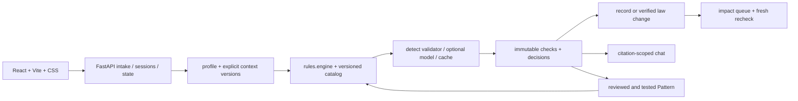

# LexCheck — kế hoạch build theo tầng, 31/10/2026
Chốt phạm vi 12:58, làm rõ gate lúc 13:23 theo user: làm toàn bộ bảng Today, nhưng gate chỉ kiểm soát việc bật flag; mỗi người xong gói của mình có thể code tầng kế ngay trong thư mục riêng, sau flag mặc định tắt và PR riêng có test xanh. Repo là bản chính: `docs/plan/`.
Proposal final: nhận tín hiệu **12:48:37 +07** tại `plans/261031-1105-final-proposal/FINAL-READY.md`; đã đọc toàn bộ 11 trang. PDF SHA256 `3dd1967ec3633e92af207ae0b223123db88c0bcd169590e8a76b0a8f8e413d5c`. Đường dẫn PDF/DOCX gốc được lưu nội bộ trong `proposal-source.txt`, cạnh bản workspace của plan; không đưa tên nội bộ vào repo public.

## 1. Một lát cắt xuyên suốt
Company DEMO phân phối TPBVSK P-01: dossier + ma két marketing + chỉ mục chứng cứ tổng hợp → xác nhận profile → kiểm rule có nguồn → finding có applicability, clause/version/evidence → quyết định → hồ sơ đổi → rà lại → sửa có người duyệt → đóng task. Bổ sung chat, thay đổi luật, quyền và feedback trên chính luồng này. Không dựng ngành thứ hai.
Dùng JSON/chữ theo cấu trúc Mẫu 02, 10/11 NĐ 15/2018, nhãn **synthetic/staged**. Hai ma két P-01 phụ thuộc dossier v1; v2 bỏ một công dụng: cả hai được rà lại, chỉ một cần thêm chứng cứ. P-02 là đối chứng không bị ảnh hưởng. Chọn dữ liệu này vì có gold queue/span và không cần OCR hay hồ sơ thật; xem [data.md](data.md).

## 2. Các tầng và kịch bản demo độc lập
| Tầng / cửa sổ | Phần bắt buộc của tầng | Demo khi dừng ở đây | Gate bật |
|---|---|---|---|
| 0, ngay sau checkpoint 2 → **14:05** | nạp fixture/profile; ≥3 rule Dũng đã xác minh; finding clause/version/evidence/applicability; reviewer session; quyết định; dossier change, queue, history; sửa thủ công, recheck, đóng task; deploy | 90 giây bên dưới, không key | main có `make test`, `make smoke LAYER=0`, browser smoke và live URL xanh |
| 1, **14:05–14:45** | validator đủ 5 kiểm + retry một lần; keyword và chat thuần cùng model/input trên dev; chatbot hẹp có citation; assign owner | demo tầng 0 + hỏi “cần bổ sung gì?”, xem citation và bảng baseline có n, giao task | tầng 0 đã xanh trên main; smoke1 xanh; bật LEXCHECK_LAYER1_ENABLED=1 |
| 2, **14:45–15:10** | NQ 21/2026 preloaded: người duyệt diễn giải → rule version mới → kích hoạt theo ngày → queue affected; 5–8 rule đã kiểm theo đúng phạm vi | demo tầng 1 + before/after 01/07, giữ kết quả cũ; số giấy cũ không tự bị suy mất hiệu lực | tầng 1 đã bật trên main; smoke2 và nguồn Dũng xanh; bật LEXCHECK_LAYER2_ENABLED=1 |
| 3, **15:10–15:30** | user demo manager/operations; backend authorize trước retrieval/action; feedback được duyệt, test guard, Pattern theo company/pack/clause version; old/new cạnh nhau | demo tầng 2 + đổi user: record riêng bị chặn; manager duyệt Pattern, ca tương tự được bắt không thêm model call | tầng 2 đã bật; smoke3 + test quyền mọi đường đọc xanh; bật LEXCHECK_LAYER3_ENABLED=1 |

P0 = tầng 0. P1 = tầng 1–3 theo thứ tự user đã chốt, là mục tiêu Today chứ không được bỏ khỏi job. P2 ngoài hôm nay: OCR, crawler, Neo4j, ngành nhà trọ, RAG rộng, quản lý tenant thật, tự động học chưa qua người duyệt, B+/RAG baseline. Dùng JSON adjacency, không cần NetworkX.
Mặc định mọi flag tầng 1–3 = 0. Không bật flag chỉ vì endpoint tồn tại. Main luôn giữ demo tầng hoàn tất gần nhất; flag tắt trả 404 feature_disabled, không gọi model và không đổi state. Chỉ người vận hành đổi env sau khi lưu SHA + smoke vào ledger. Tắt tầng thấp phải tắt các tầng phụ thuộc. Mọi PR merge do người thực hiện, không agent merge PR người khác.

## 3. Demo tầng 0 trong 90 giây
- 0–15s: mở Company DEMO, badge synthetic/staged, profile advertising/domestic_distributor, dossier v1 và hai ma két; bấm Check, N là số rule thật chạy.
- 15–30s: thấy kết quả ban đầu; đổi dossier v1→v2 bằng event tổng hợp, không sửa snapshot cũ.
- 30–50s: queue N=2 ma két; recheck: K=1 có công dụng cần chứng cứ, M-02 vẫn không bị R-02; P-02 không vào queue.
- 50–65s: mở finding: nguyên văn marketing + clause/version + ngày + applicability; “not found in the connected records” không phải kết luận chưa từng làm.
- 65–90s: reviewer confirm; chỉnh ma két bằng bản v2 chỉ bỏ công dụng chưa được chứng minh, giữ công dụng còn lại; recheck mới → reviewer đóng task; history hiện bản trước/sau.
Nếu chưa có ≥3 rule thật trước 14:05: vẫn nộp WIP đúng giờ nhưng ghi gate tầng 0 chưa đạt, giữ flag tầng 1 tắt và không gọi fixture là sản phẩm hoàn tất.

## 4. Kiến trúc và điểm cắm

One service: FastAPI phục vụ ui/dist, API đăng ký sẵn; Vite dev proxy /api tới :8000. Python 3.11. Node 22. OPENAI_MODEL qua env, key chỉ server; duy nhất detect/client.py gọi SDK. Tầng 0 chạy không key. `create_app()` tạo state riêng; configure_app ở intake/runtime.py là điểm cắm store/auth, không sửa app/main.py.
Rule/clause/record snapshots bất biến. context_version_ids là căn cứ người duyệt chọn; received_at khác effective date. N không gồm rule disabled, không cùng phạm vi hoặc chưa chạy. Nhóm unknown → chưa đủ thông tin, không no_issue_found. Catalog tĩnh là dữ liệu nguồn; legal activation tạo overlay runtime, không ghi ngược rules/catalog.json.

## 5. Chủ thư mục, không sửa chéo
| Chủ | Độc quyền | Điểm bàn giao |
|---|---|---|
| Tuấn Anh | detect/, eval/, data/dev/, docs/ledger/tuan-anh.md | validate_findings, suggest, chat.answer, eval report/baselines/cache |
| Dũng | rules/, fix/ nếu cần, docs/ledger/dung.md | evaluate, impact.enqueue/apply_event, legal activation logic, pattern guard; dữ liệu luật đã xác minh |
| Khanh | intake/, ui/, deploy/, docs/ledger/khanh.md | store/session/auth/router, API orchestration, reviewer UI, smoke tầng, một service deploy |
| Chung — PR hợp đồng riêng, cả đội đọc | contracts/, schemas/, tests/, scripts/, data/fixtures/, app/, Makefile, requirements.txt, CI, AGENTS.md, README, docs/plan/, docs/build-ledger.md | Tuấn Anh điều phối; không feature PR tiện tay đổi |
Khanh kế thừa UI JavaScript/CSS của PR #1 sau human review/merge, không port sang TypeScript/Tailwind; client kiểm JSDoc/schema. Khanh và Dũng xác nhận bàn giao UI (PR từ tài khoản Dũng); Dũng tiếp tục rules/fix. package-lock của PR UI đầu được cả đội đọc; từ đó đổi dependency phải PR riêng. Không ai sửa file ledger người khác. Leader tổng hợp build-ledger. Các job chỉ import model chung; test tính năng nằm trong thư mục chủ sở hữu.

## 6. Mốc thực thi và tích hợp
| Giờ +07 | Hành động / chủ / tiêu chí |
|---|---|
| trước tín hiệu code | Dũng đối chiếu R-01..03 và nguồn hiện hành; Khanh xác nhận tài khoản deploy/Node/model dùng được, giữ key riêng; Tuấn Anh chuẩn bị tập cuối bằng tay ngoài repo, không đưa Codex xem |
| ngay sau checkpoint 2, mục tiêu ~13:30 | cả ba mở worktree/clone riêng, đọc job, dán prompt; không đợi đúng 13:30 nếu được báo sớm |
| 13:30–14:00 | các gói tầng 0 chạy trên fixture độc lập; PR nhỏ theo hợp đồng; người review xong merge khi test+smoke xanh |
| **14:05** | tích hợp 1 trên main: tầng 0 thật, >=3 rule, no-key smoke, live URL; cả đội thử ở máy khác |
| **14:15** | Khanh giữ phiên demo ổn định; Tuấn Anh chốt README/ảnh trạng thái WIP |
| **14:25** | Tuấn Anh gửi WIP; hạn BTC 14:30; Dũng dự phòng |
| 14:45 | gate tầng 1, bật flag nếu đầy đủ; chưa đạt thì flag tầng 2 vẫn tắt; người xong gói của mình có thể code tầng 2 trong PR riêng |
| 15:10 | gate tầng 2; Tuấn Anh chốt SHA/cấu hình/rule/model/dev dataset cho final; không đẩy thay đổi vào bản eval đang chạy |
| **15:15 cố định** | Tuấn Anh human chạy held-out một lần trên SHA đã khóa; tầng 3 có thể ở branch/off-flag nhưng không đổi bản đo |
| **15:30** | freeze; tắt mọi tầng chưa đạt; ghi chênh lệch Today và SHA demo khác SHA eval nếu có |
| 16:00 / **16:15** / **16:30** | video/tập pitch; checklist; Tuấn Anh bấm gửi, Dũng dự phòng; hạn BTC 17:00 không dời |
Mỗi người đi từ tầng 0 lên, gói ≤45 phút trong job. Xong báo nhóm + PR + test output, làm tiếp gói tầng kế trong thư mục riêng sau flag tắt, PR riêng và test xanh. Không chờ nhóm khi không có phụ thuộc. Nếu start trễ, rút phần giao diện trang trí, không rút nguồn/validator/history/smoke.

## 7. Chênh lệch với bảng Today — cập nhật tại 15:30
Đây là mục kiểm thực tế, không phải danh sách tính năng đã hoàn thành. Bootstrap hiện chưa đạt tầng 0.
| Hứa trong Today | Tầng | Trạng thái hiện tại / cách sửa write-up nếu chưa đạt |
|---|---|---|
| records/profile/findings, quyết định/recheck/closure | 0 | chưa triển khai; chỉ mô tả phần thật chạy nếu gate không đạt |
| validator, chat thuần, chatbot, assignment | 1 | chưa triển khai; báo thiếu số baseline nếu API/cache chưa đủ, không dùng dữ liệu giả |
| verified legal change, 5–8 rule | 2 | chưa triển khai; ghi N thực đã xác minh, thay đổi luật chỉ là preloaded nếu đã chạy |
| hai nhóm quyền, feedback reuse | 3 | chưa triển khai; flag off nếu chưa test đủ, không biểu diễn login đổi nhãn như có quyền backend |
| held-out 40–60 ca trong proposal | 15:15 | người viết tập cuối tự quyết số thực; nếu ít hơn ghi đúng n và giới hạn, không hứa 40–60 |
| B+/RAG, workbook/PDF/OCR rộng, mọi metric dài hạn | ngoài lát cắt | chưa build; sửa write-up thành roadmap, không suy graph tốt hơn khi chưa đo |
Thứ tự cắt khi hết giờ: không bật tầng 3 → không bật tầng 2 → không bật tầng 1; giữ tầng trước hoàn chỉnh. Trong tầng: bỏ trang trí/diff từng từ/auto-fix trước; không bỏ validator, căn cứ verified, baseline đã cam kết cho tầng 1, record history hay gate. Nếu final eval không đo được hệ nào, ghi unavailable và lỗi, không coi là âm tính.

## 8. Tài liệu thực thi
- [contracts.md](contracts.md): toàn bộ model, endpoint, lỗi, auth/flags và JSON mẫu.
- [job-1-tuan-anh.md](job-1-tuan-anh.md), [job-2-dung.md](job-2-dung.md), [job-3-khanh.md](job-3-khanh.md): gói có giờ/test, prompt Codex tự đủ.
- [testing.md](testing.md), [data.md](data.md), [submission.md](submission.md).

PR tầng kế có thể viết sớm khi gói của người đó xong; nếu cần commit chưa merge của chính mình thì ghi rõ PR phụ thuộc. Không force-push; phối hợp base/merge với người review. Các giờ trong job là cửa sổ bật/tích hợp dự kiến, không cấm hoàn thành code sớm. Mốc14:05/14:25/15:15/15:30/16:30 giữ nguyên.
