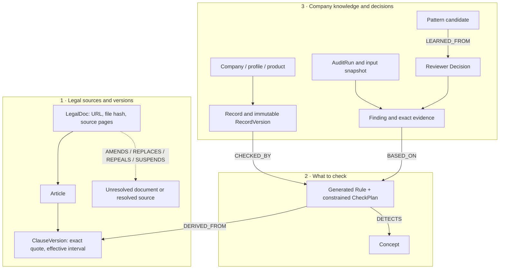

# Company → legal discovery → generated rules → fast audit

This is the user-requested dynamic ingestion core, separate from the static runtime catalog and the developer reference pack. It never reads `rules/examples/` or uses sample rules as output/fallback. It is currently a local CLI/library, not a mounted web endpoint or UI feature. No deployment layer flag is enabled by this package.

## Three graph layers from proposal §4.1



IDs are content-derived and server-created. A changed snapshot requires a new version ID; existing node contents cannot be overwritten. The graph supports provenance traversal and reverse impact queries, including records with no finding; when a path is missing, callers can conservatively include all records of the product. Model-suggested legal relations remain labelled **candidate** with their quoted basis, page and effective date. A referenced document not yet ingested stays unresolved; the next search receives those document names. Storing a relation does not activate an interpretation or replace an earlier rule.

`record_decision` accepts an existing canonical `Decision` from an already-authorized service; it checks that the finding belongs to the cited check snapshot. `record_pattern_candidate` records only same-company candidates from a confirmed decision and exact evidence. Promotion/learning execution and server authorization remain separate API-owner responsibilities. This CLI does not implement production login, workspace access control or learning promotion.

## How research stops

1. LLM derives a small list of explicit legal questions from the supplied company description and canonical profile. No rule answers or developer examples are provided.
2. Search is restricted to allowlisted official domains. Returned URLs must also appear in the actual hosted web-search sources/citations of that turn. The host fetches original content, validates redirects, caps size/pages and extracts text locally.
3. LLM receives only selected source pages and proposes company obligations, check operations, scope, exceptions, dates and relations. The host checks the exact quote, page and article heading, creates IDs, and attaches the actual file hash. Government oversight duties are not company checks. Unknown dates, fabricated quotes and unsupported shared rule categories create explicit errors/gaps.
4. Stop on planned-topic coverage **and no unresolved document frontier**, or on a source/round/rule/time/stall budget. Defaults: 6 rounds, 8 source attempts, 24 generated rules, 180 seconds, or 2 rounds with no new URLs. Every stage receives the remaining time budget.

**Topic coverage is a collection heuristic, not a claim that every applicable law has been found.** It means at least one source-grounded candidate for each planned question. Model planning can itself miss a topic; absence of a graph path does not establish absence of an obligation. The report preserves missing topics, unresolved references, rejected candidates, provider failures and the actual stop reason. Review source coverage before making a decision.

## Generation and audit are separate

Generated outputs reuse `contracts.models.Rule`, `ClauseVersion`, `Evidence`, `Finding` and company/record models. Internal DTOs describe the research plan and constrained check instructions; shared contracts are not changed. The current domain pack still limits `Rule.check_type` and company activity/product enums. Unsupported obligations are reported for schema/pack extension rather than silently squeezed into a supported category.

The model generates **arguments and scope**, not executable Python or arbitrary regular expressions. Supported fast operations are:

- `required_text`: find a generated literal; a missing match creates a review suggestion.
- `forbidden_text`: locate a generated literal with exact original Unicode offsets; negation/context remains for review.
- `uses_subset`: compare claimed uses against the explicitly selected product dossier; extra uses request scientific-evidence review, even if a supporting document is linked.
- `required_reference`: check a selected, directly linked record of the generated kind and same product.
- `model_review`: kept as an unexecuted/manual item in this first version.

Audit uses saved generated plans and local records: **0 search/model calls for these deterministic operations**. Missing/ambiguous interpretation is not treated as a clean result. Every output is `candidate_preview` / `not_enough_information`; findings use the canonical model-suggestion/evidence-review statuses. Candidate exceptions and uncertainties remain visible. Exact quote grounding does not prove current legal applicability, scientific support or interpretation. Human-verified activation in the main engine is intentionally separate; nothing writes to `rules/catalog.json` or `rules/clauses.json`.

Each audit stores a separate graph snapshot and immutable audit input, including clean checked records for impact tracing. Older discovery/audit files stay available. A changed review date requires refreshed legal discovery.

## Running with OpenAI API

The SDK adapter is supplied in a **separate coordinated PR**, at `detect/client.py`, as required by `AGENTS.md`. Install/merge that adapter before invoking live ingestion. The core can be tested offline through an injected transport. `--transport module:factory` is an explicit extension point for the application owner.

Set private `.env` entries at repository root:

```dotenv
OPENAI_API_KEY=your-key
OPENAI_MODEL=your-model-with-web-search-and-structured-outputs
```

The loader reads only these two keys, never executes the file, and does not override an existing process setting. Keys stay server-side and are not printed, cached or committed. Model selection is explicit; no model name is guessed. Live work is opt-in through `--live`. The adapter uses Responses API, JSON Schema structured output and hosted `web_search`; extraction has no tools. Search cache keys include company context, purpose, model, schema, prompt version, dates and actual source content in extraction payloads. Successful real outputs only are cached privately for at most an hour. No sample response is substituted on timeout/refusal/error.

```powershell
# From repository root; the input is a synthetic canonical CheckRequest or DemoBundle.
.venv/Scripts/python.exe -X utf8 -m rules.discovery_cli ingest --input data/fixtures/demo.json --description "Doanh nghiệp DEMO phân phối TPBVSK, quảng cáo bằng chữ trên mạng" --output cache/discovery/company.json --live
.venv/Scripts/python.exe -X utf8 -m rules.discovery_cli audit --input data/fixtures/demo.json --graph cache/discovery/company.json --output cache/discovery/audit.json
```

Native PDF text extraction uses optional `pypdf`. If absent, use an approved text-bearing source or install it locally without changing shared dependency files. Scanned PDFs produce an explicit OCR-required gap, not invented text. An injected fetcher can supply reviewed page text from a separate OCR/upload workflow. The current CLI automatically discovers web sources; an upload UI is not part of this package.

An optional `--source-url https://...` supplies an official law URL already provided by the user. The model still plans/searches; this URL is retrieved as source text, never as a prewritten rule. Provenance distinguishes these supplied seeds from model-discovered URLs. Source page selection always retains the document opening and effectivity sections before ranking topical pages, so publication/effective-date context is not lost to token trimming.

Company role and activity are attached to generated plans. A model-proposed responsibility of a ministry/authority is not a company obligation and is rejected. Candidate suspension/repeal/replacement edges effective before the review date put affected source rules on a temporal-review hold; they do not silently activate a new interpretation or declare a document conclusively void.

Output files belong under ignored `cache/`; they may contain company records. Do not add them, `.env`, PDFs, raw OCR drafts or archives to Git. The CLI refuses held-out evaluation paths. Tests use only synthetic public dev records and injected model/fetch responses; no test accesses network or keys.

## Checks

```powershell
.venv/Scripts/python.exe -X utf8 -m pytest rules/tests/test_discovery.py -q
# With the separately supplied adapter:
.venv/Scripts/python.exe -X utf8 -m pytest rules/tests/test_discovery_client.py -q
```

Tests cover source grounding/article location, stopping with explicit gaps, graph isolation/immutability, cached graph tampering, audit with newly generated text rather than a rule-ID registry, no new model calls during audit, source URL allowlisting, preserved old records and source-only SDK tool use. They do not establish legal accuracy or discovery recall. Live-run counts are reported separately from test results.
